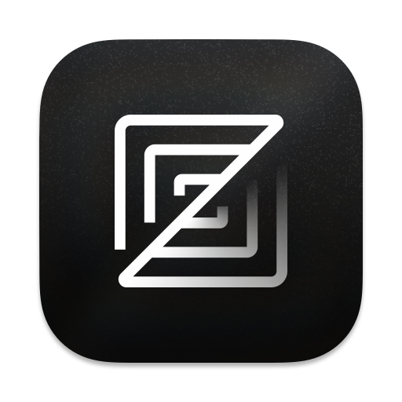

# Coding agents on Windows, and the shell they run

Your agent does not run commands in *your* shell. It picks one, and on Windows
that pick is made by a probe you can usually influence. This page lists the
mechanisms, the agent-by-agent behaviour, and what niu has to provide.

The roster below tracks the agent directory on
[unixwin.dev](https://unixwin.dev/agents/): **24 agents** in five groups —
ready (terminal-native), the VS Code family, partial, blocked, and
not-yet-verified. The original machine verification was done on 2026-10-16
(niu 1.4.0, niu-git 2.55.0.5 flat layout, Git for Windows 2.50.1 at `D:\Git`,
a WSL2 distro installed; opencode, codex (forked), ZCode). Entries added in
the 2026-10-21 expansion are marked **source-verified** when the claim comes
from reading shipped code rather than a live run; entries from upstream issue
threads are marked as reported. Behaviour statements track the current
release, v1.4.3.

## The one thing that usually just works

Launch the agent **from a niu session**:

```
niu
$ opencode          # or codex, or any CLI agent
```

niu exports `SHELL=<path to niu.exe>`. Agents that follow the POSIX convention
read `$SHELL` and use it. That is how the agent driving this document runs: its
process tree is `powershell.exe <- niu.exe <- opencode.exe`, and opencode's
shell selector is literally

```js
function o$(e, r) { return Xc(process.env.SHELL, void 0, r, e) ?? n$(e); }
//                                                ^ which("bash") ?? "/bin/sh"
```

opencode has no niu-specific code at all (zero occurrences of `niu` in the
binary) and no config field for the shell; `$SHELL` is the whole mechanism.

The catch: `$SHELL` is **not persisted** by anything. It exists only in
processes descended from a niu session. Start the agent from the Start menu or
Explorer instead and `$SHELL` is empty, so the same agent falls through to
`which("bash")`, which on a machine with WSL resolves to
`C:\Windows\System32\bash.exe` and runs your commands in **Linux**.

## The four mechanisms

| # | Mechanism | Reads | Covered by launching from niu |
|---|---|---|---|
| 1 | `$SHELL` (POSIX convention) | the environment | yes |
| 2 | Explicit per-agent setting | config file / CLI flag | n/a, set it once |
| 3 | Git for Windows probe | hardcoded paths, or derived from `git` | no |
| 4 | Bare name, a table, or PowerShell by default | `PATH`, `ComSpec`, `PATHEXT` | partly |

Mechanism 3's hardcoded `C:\Program Files\Git` candidates are **deliberately
not claimed** by the niubash installer (the niubash#398 ruling: a per-user
install never writes an admin-walled foreign directory — see
[the installer contract](installer.md#the-git-bash-slot-is-never-claimed)).
What hits niu today is the probe's second arm — the `bash.exe` derived from
the `git` found on `PATH` — plus explicit settings (mechanism 2). Mechanism 4
is why a bare `bash` cannot be redirected from the user `PATH` alone.

### What `winuxcmd\bin\bash.exe` actually is

Since niubash#377 it is **niu itself under another name**: the installer runs
`niu --relink-shells`, which links `bash.exe`/`sh.exe` as hardlinks to
`niu.exe` wherever the filesystem allows, and the engine takes the face from
`argv[0]` (`$0`, `BASH_VERSION`, POSIX mode for `sh`). No extra process, no
launcher hop — the ~13 ms per-`-c` tax a forwarding launcher costs
(niubash#377) exists only on filesystems without hardlinks, where the
fallback is a forwarding shim that sets `NIU_INVOKED_AS` and re-execs `niu`
with argv preserved.

The other historical wart is also closed: a console-less parent used to get a
**visible console window** per command through the launcher chain
(niubash#379 — Claude Code flashed a window for every command). The fix
family shipped in **v1.4.2**: `CREATE_NO_WINDOW` on redirected spawns
(rubash#668, rubash#909), the winuxcmd-shim launcher suppressing orphan
consoles (WinuxCmd#1282), and one hidden console per niu session instead of
one per child (niubash#462 — see [Performance](performance.md)).

## Which shell is my agent actually using?

Ask the agent to run this and compare the signatures:

```
echo "SHELL=$SHELL"; uname -s; uname -a
```

| What you see | Shell | Notes |
|---|---|---|
| `uname -s` = `MSYS_NT-...`, `uname -a` ends `x86_64 Msys` | **niu** (winuxcmd shim) | what you want; `$SHELL` points at `niu.exe` |
| `uname -s` = `MINGW64_NT-...`, `MSYSTEM=MINGW64` | Git Bash | Git for Windows' own runtime |
| `uname -s` = `Linux` | **WSL** | the surprising one; the agent reached `System32\bash.exe` |
| `uname` not found, `$SHELL` empty | PowerShell or cmd | check `$PSVersionTable.PSVersion` vs `%COMSPEC%` |

The same check appears in Cursor's own support threads, where the fix is
verified by `uname -a` ending in `MINGW64_NT-...` instead of
`microsoft-standard-WSL2`.

Interpreting the result:

- `Linux` means the agent fell through to `which("bash")`. Fix the mechanism
  that agent uses, below.
- `MINGW64_NT` means it found Git Bash. If you want niu instead, set the
  agent's explicit shell (mechanism 2) or the `$SHELL` variable.
- Empty `$SHELL` with PowerShell means the agent defaults to PowerShell, which
  is safe but not bash-compatible.

## Agent reference

| | Agent | Status | Mechanism |
|---|---|---|---|
|  | opencode | ✅ ready | `$SHELL` |
|  | Claude Code | ✅ ready | git-derived probe / `CLAUDE_CODE_GIT_BASH_PATH` |
|  | Codex (unixwin fork) | ✅ ready | native `ShellType::Niu` detection |
|  | Zed | ✅ ready | `terminal.shell.program` |
|  | Goose | ✅ ready | `GOOSE_SHELL` |
|  | DSH (DeepSeek Harness) | ✅ ready | plugin profile |
|  | VS Code (Copilot agent) | ✅ ready | VS Code family probe / `automationProfile` |
|  | Windsurf | ✅ ready | VS Code family probe |
|  | Trae | ✅ ready | VS Code family probe |
|  | Kiro | ✅ ready | VS Code family probe (inferred) |
|  | ZCode | ✅ ready | VS Code family probe (verified) |
|  | Cline | ✅ ready | editor terminal / `automationProfile` |
|  | Roo Code | ✅ ready | editor terminal / `automationProfile` |
|  | Kilo Code | ✅ ready | editor terminal / `automationProfile` |
|  | Continue | ✅ ready | editor terminal / `automationProfile` |
|  | Cursor | ⚠️ partial | IDE workaround exists; Agent CLI hardcodes PowerShell |
|  | Devin | ⚠️ partial | no native integration; TUI blocked by niubash#455 |
|  | Qwen Code | ⚠️ partial | `MSYSTEM`/`TERM` sniff → Git Bash lookup |
|  | Gemini CLI | ❌ blocked | unconditional PowerShell |
|  | Aider | ❌ blocked | no shell option |
|  | Amazon Q Developer CLI | ❔ unverified | — |
|  | Amp | ❔ unverified | — |
|  | OpenHands | ❔ unverified | — |
|  | Junie (JetBrains) | ❔ unverified | — |

### Works out of the box — terminal-native agents

#### opencode

- **Mechanism:** `$SHELL` first, then `which("bash")`, then `/bin/sh`. Its
  `gitbash` mode is implemented as "use `$SHELL`". No config field; the V2 CLI
  settings and core config have no shell key.
- **Set it to niu:** launch from niu, or persist `SHELL` to the user
  environment (`[Environment]::SetEnvironmentVariable('SHELL',
  "$env:LOCALAPPDATA\Programs\Niubash\niu.exe", 'User')` in PowerShell) to
  cover every launch path. Nothing else is read.
- **Failure mode:** falls to `which("bash")` -> `System32\bash.exe` -> **Linux**.
- **Separate code path:** the self-updater resolves
  `git --exec-path` up three levels plus `bin\bash.exe` and refuses to update
  with "Git Bash is required to update OpenCode" when that file is missing. It
  does not consult `$SHELL`. The niu-git package manifest places
  `...\winuxcmd\opt\niugit\bin\{bash,sh}.exe` so the probe resolves and a `wpm`
  refresh keeps it. See niubash#376.
- **Source:** shipped binary, read locally.

#### Claude Code

- **Mechanism:** vendor docs. Without `CLAUDE_CODE_GIT_BASH_PATH` it looks for
  `bash.exe` in (1) `C:\Program Files\Git` and `C:\Program Files (x86)\Git`,
  then (2) the `git` on `PATH`, using `bin\bash.exe` from that installation. It
  skips a `git` sitting in the launch directory or below it, or under
  `node_modules`/`.venv`/`env`.
- **Set it to niu:** probe (1)'s hardcoded directories are deliberately left
  unclaimed by the installer (the niubash#398 ruling — see below), so today it
  is probe (2) that lands on niu: the `git` on `PATH` resolves into
  `winuxcmd\bin`, whose `bash.exe` is the niu face described above. For
  explicit control, set `CLAUDE_CODE_GIT_BASH_PATH` in `settings.json` to
  `...\winuxcmd\bin\bash.exe`.
- **Trap:** the variable only accepts a file named `bash.exe`, `sh.exe`, `bash`
  or `sh`. Point it at `git-bash.exe` and it is ignored with a warning. Pointing
  it at `niu.exe` is likewise ignored — but the hardlinked `bash.exe` *is*
  `niu.exe` under an accepted name, so the accepted-name requirement costs
  nothing now that niubash#377 landed the `argv[0]` dispatch.
- **History:** this configuration is the one that exposed niubash#379 (a
  visible console window per command through the forwarding launcher). Fixed
  in rubash#668 and shipped in v1.4.2 — if you still see the flash, upgrade.
- **Failure mode:** since v2.1.120, absent Git Bash means **PowerShell**, not
  Linux.
- **Source:** vendor documentation.

#### Codex

- **Mechanism:** a shell table with per-shell candidate paths. Windows entries
  include `bash -> /bin/bash`, `sh -> /bin/sh`, `pwsh`, `powershell`, `cmd`.
- **Set it to niu:** the unixwin-maintained fork adds `ShellType::Niu` with
  `C:\Program Files\Niubash\niu.exe`, `C:\Program Files (x86)\Niubash\niu.exe`,
  `%LOCALAPPDATA%\Programs\Niubash\niu.exe` and a `niu` lookup on `PATH`; the
  exec policy also whitelists `niu.exe -C`, `-c`, `-lc`, `--repl-command`.
  Zero configuration: install the fork and niubash and it is selected. This
  is the shape the other agents need.
- **Source:** `codex-rs/shell-command/src/shell_detect.rs`, read locally.

#### Zed

- **Mechanism:** explicit. `terminal.shell.program` names the shell, and the
  agent uses that terminal.
- **Set it to niu:** point `terminal.shell.program` at `niu.exe`.
- **Source:** settings in use on this machine.

#### Goose

- **Mechanism:** `GOOSE_SHELL`. On Windows the shell tool reads
  `GOOSE_SHELL`, defaults to `cmd`, and dispatches argument style by file
  name: `pwsh`/`powershell` get `-Command`, `cmd` gets `/C`, and **every other
  name gets `-c`** — which is exactly niu's one-shot syntax.
- **Set it to niu:** persist `GOOSE_SHELL` to the niu path (same
  `[Environment]::SetEnvironmentVariable` pattern as `$SHELL` above), open a
  new terminal, run `goose`, and have it execute any command — the output is
  bash dialect, not cmd.
- **Source:** source-verified (2026-10-21 HEAD):
  `block/goose` `crates/goose/src/agents/platform_extensions/developer/shell.rs`,
  `windows_shell()` and the argument dispatch. Not yet run per-machine; the
  desktop app has separate login-shell logic (`ui/desktop loginShellPath`) —
  the CLI behaviour is what counts here.

#### DSH (DeepSeek Harness)

- **Mechanism:** plugins. `dsh-niu` ships a profile bundle that enables
  `niu-sandbox` and `tool-bash`, disables the PowerShell shell/tool rows, and
  adds a settings card. A third party ships `dsh-niubash-only` in the same
  spirit.
- **Set it to niu:** `dsh plugin --profile web add @cmx666/dsh-niu-bundle@<version>`.
- **Source:** the plugin READMEs.

### The VS Code family

Cursor aside, the VS Code family is **one shared probe**:

```js
var HX = ["C:\\Program Files\\Git\\bin\\bash.exe",
          "C:\\Program Files (x86)\\Git\\bin\\bash.exe"];
// then: which("git") -> dirname(git) + "/../bin/bash.exe" and "/../../bin/bash.exe"
```

- **Applies to:** VS Code (Copilot agent), Windsurf, Trae, Kiro, ZCode, and
  extensions that use the editor's terminal or automation profile (Cline, Roo
  Code, Kilo Code, Continue). Cursor is VS Code lineage too, but both of its
  products route around this probe — it gets its own entry under *partial*.
- **Set it to niu:** the hardcoded candidates stay unclaimed (the #398 ruling
  again), so today the `which("git")` arm is the one that lands on niu's
  `winuxcmd\bin\bash.exe` — fix the entry directory once and the whole family
  follows. For explicit control, point the automation profile at niu:
  `terminal.integrated.automationProfile.windows` =
  `{"path": "<niubash>\\niu.exe", "args": []}`. Agents that shell out through
  the automation profile inherit it.
- **Failure mode:** PowerShell, or cmd if neither is configured.
- **Source:** the probe sequence above was read out of ZCode's `app.asar`
  locally — ZCode is the family's verified member; the rest share the
  lineage. Kiro is the one family entry the original probe list did not name
  — it is Code OSS lineage and is listed here on that basis; per-machine
  confirmation welcome.

#### The editor extensions

Cline, Roo Code, Kilo Code and Continue do not pick a shell at all: commands
run through the host editor's terminal or automation profile, so they inherit
whatever the family probe resolved. Set the host editor's
`automationProfile` (or leave the git-derived arm to find niu) and every
extension follows.

### Partial — a workaround exists

#### Cursor

Two products, both currently unhelpful:

- **IDE agent:** ignores `terminal.integrated.defaultProfile.windows` and
  `terminal.integrated.automationProfile.windows` and runs PowerShell; the
  workaround is enabling the *Legacy Terminal Tool* setting. Some versions pick
  WSL bash instead, which is why their threads recommend nulling the PowerShell
  and WSL profiles with `terminal.integrated.useWslProfiles: false`.
- **Agent CLI:** hardcoded to PowerShell. No `--shell` flag, no shell field in
  `~/.cursor/cli-config.json`, and `$SHELL`/`$COMSPEC` ignored. The shipped
  `detectShellType()` puts `isWindows && (commandExists("pwsh") ||
  commandExists("powershell"))` in the same `||` chain as the string match, so
  on Windows the PowerShell arm fires regardless of the hint and every later
  branch is unreachable. A working `NaiveTerminalExecutor` exists but nothing
  routes to it.
- **Set it to niu:** not possible today through configuration. Reported
  upstream; nothing to do on the niu side until they expose a shell path.
- **Source:** upstream issue threads quoting the shipped detection code.

#### Devin

- **Mechanism:** none — there is no niubash native integration (no
  `ShellType::Niu`-style detection, no plugin profile, no install hook). It
  *launches* fine from a niu session, but its shell selection is unverified.
- **Known blocker:** niubash#455 (open). `devin.exe` v3000.11.92 drives its
  interactive TUI through the legacy Win32 console API
  (`ReadConsoleInputW`/`SetConsoleCursorPosition`) when stdout is a real
  console — under niu that path currently renders a white screen and dead
  keys. With stdout a pipe it takes an ANSI fallback path that works. Two
  upstream-side bugs ride along: the install script's `curl|bash` runs
  `devin setup` unconditionally with no tty check, and `setup` does not exit
  on stdin EOF. rubash#913 fixed the spawn-side half (one hidden console per
  session); the TUI console channel is the remaining work — watch the issue.
- **Workaround today:** run `devin setup` once in a normal terminal
  (PowerShell / Windows Terminal) to complete login, then drive `devin` from
  a niu session for non-TUI work.
- **Source:** niubash#455 investigation (2026-10-21); no per-machine shell
  verification. "Not verified here" alumni — promoted out of the list with
  findings, not with a working setup.

#### Qwen Code

- **Mechanism:** since forking gemini-cli (v0.8.2, per its README
  acknowledgement) it has carried its own detection — different from the
  parent's unconditional PowerShell: `MSYSTEM` starting `MINGW`/`MSYS`, or
  `TERM` containing `msys`/`cygwin`, routes to `findGitBashPath()`, which
  scans `PATH` for `bash.exe` and then checks the two hardcoded
  `C:\Program Files[ (x86)]\Git\bin\bash.exe` candidates. Otherwise it falls
  back to `ComSpec` (cmd/PowerShell).
- **Set it to niu:** `MSYSTEM` is empty in a niu session and setting it is a
  documented experiment (see *Known traps*). With `MSYSTEM=MINGW64` persisted
  to the user environment, the `PATH` arm of `findGitBashPath()` hits
  `winuxcmd\bin\bash.exe` — the niu face — before ever reaching the unclaimed
  Program Files candidates.
- **Source:** source-verified (2026-10-21 HEAD):
  `QwenLM/qwen-code` `packages/core/src/utils/shell-utils.ts`
  (`getShellConfiguration()` / `findGitBashPath()`). Read-code conclusion, not
  yet run per-machine; a successful live run promotes this to ready.

### Blocked — no supported path today

#### Gemini CLI

- **Mechanism:** `getShellConfiguration()` returns PowerShell unconditionally on
  Windows. `ComSpec` is only consulted to decide between `pwsh` and
  `powershell.exe`; there is no bash branch.
- **Set it to niu:** not possible in released code. Two upstream proposals
  exist: detect MSYS via `process.env['MSYSTEM']` and route to `bash -c`
  (issue #26567), and prefer Git Bash by searching `PATH` for a `bash.exe`
  whose path contains `git` (PR #18367). Its fork Qwen Code already
  implemented the first idea — see that entry.
- **Failure mode:** PowerShell, and on locked-down machines an execution-policy
  error that stops the agent entirely.
- **Source:** upstream source and issue threads.

#### Aider

- **Mechanism:** there is no shell selection option. `/run` uses PowerShell or
  `cmd.exe` on Windows, and the model-visible environment reports
  `Shell: COMSPEC=...`. `--suggest-shell-commands` and `--shell-completions` are
  unrelated.
- **Set it to niu:** not supported. Launching Aider from niu does not change
  the shell it uses for `/run`.
- **Failure mode:** cmd/PowerShell command syntax, not a bash failure.
- **Source:** upstream options reference and changelog.

### Not verified here

Amazon Q Developer CLI, Amp, OpenHands and Junie (JetBrains) have no entry
beyond the generic guidance: no per-machine run and no read selector yet.
OpenHands typically executes inside a container/sandbox, and Junie runs
inside JetBrains IDEs — whether the host terminal's shell configuration
reaches their command execution is exactly the open question (for Junie, a
first probe is pointing the IDE's built-in terminal at `niu.exe` and running
the verify command through it). The four-mechanism table and the verify
command above are the self-serve route; field reports welcome.

## What niu provides, and what is still open

| Path | Serves | Status |
|---|---|---|
| `SHELL` exported to session children | mechanism 1, for agents launched from niu | ✅ works today |
| `SHELL` persisted to the user environment | mechanism 1 for every launch path | ⬜ open — one `HKCU\Environment` value; the installer does not write it yet |
| `<root>\bin\{bash,sh}.exe`, `<root>\winuxcmd\bin\{bash,sh}.exe` | mechanism 4 bare-name users, the git-derived probes | ✅ hardlinked `argv[0]` faces via `niu --relink-shells` (installer's `[Run]`), forwarding-shim fallback off NTFS |
| `...\winuxcmd\opt\niugit\bin\{bash,sh}.exe` | opencode's updater probe (`git --exec-path` up three) | ✅ placed by the niu-git package manifest, kept by `wpm` refresh |
| `C:\Program Files[ (x86)]\Git\bin\{bash,sh}.exe` | mechanism 3 probe 1 (Claude Code, VS Code family) | ❌ **deliberately unclaimed** — niubash#398 ruling, tested invariant; revisit needs an accepted opt-in elevated task |

The entry directory `...\winuxcmd\bin` must contain only names you intend to
own globally (`git`, `sh`, `bash`), because it is what goes on `PATH`.

## Why `PATH` cannot win against `System32`

Windows resolves a bare name handed to `CreateProcess` by searching the
application directory, the current directory, **the system directory**, the
Windows directory, then `PATH`. Measured with the entry directory first on
`PATH`:

| Caller | `bash` becomes |
|---|---|
| `cmd /c bash -c 'uname -s'` | winuxcmd's bash (`MSYS_NT-...`) |
| PowerShell `& bash` | winuxcmd's bash |
| Python `subprocess(['bash', ...])` | **WSL** (`Linux`) |

Shells resolve names themselves, so `PATH` order decides for them. A process
that passes the bare name to `CreateProcess` never sees `PATH` before the system
directory, so a bare `bash` cannot be fully taken over from a per-user `PATH`.
Since the `C:\Program Files\Git` convention slot is deliberately unclaimed,
the remaining complete answer is telling callers to use `sh`, which has no
`System32` counterpart.

## Recommended order of work

1. **Installer writes `SHELL`** to the user environment, and removes it on
   uninstall. One registry value, no elevation, and it covers the largest class
   of agents including every POSIX-flavoured CLI. Users who launch from niu
   already have it; this makes it independent of the launch method.
2. **`niu setup agents`** (idempotent) creates the non-elevated paths, prints
   what each probe resolves to, and says which entries need elevation.
3. **An accepted, opt-in elevated task** is the only way the
   `Program Files\Git` candidates could ever be claimed — per the #398 ruling
   it takes evidence that an editor resolves that exact path (Claude Code and
   the VS Code family probe are that evidence) plus explicit user opt-in.
4. **Per-agent settings** for the agents that read neither `$SHELL` nor the Git
   probes: Zed, DSH (done), the Codex fork (done), the VS Code automation
   profile.

Two things not to do: do not add `winuxcmd\usr\bin` to `PATH` (hundreds of
names, including ones `System32` owns), and do not replace
`C:\Windows\System32\bash.exe`.

## Known traps

- `MSYSTEM` is empty in a niu session. Tools that sniff MSYS through it
  (Qwen Code's shipped detection, Gemini CLI's proposed fix) will not see niu
  by default. Setting it is untested and changes how other MSYS-aware tools
  behave, so treat it as an experiment.
- `uname` in the winuxcmd shim reports `MSYS_NT-...`. Anything that branches on
  `uname` will classify the host as MSYS, which is deliberate for
  compatibility but visible to autotools and similar.
- Claude Code accepts only `bash.exe`/`sh.exe`/`bash`/`sh` in
  `CLAUDE_CODE_GIT_BASH_PATH`.
- A `bash` that resolves to Windows' WSL launcher starts Linux bash, and there
  is no error: the agent simply runs your commands on another OS.
